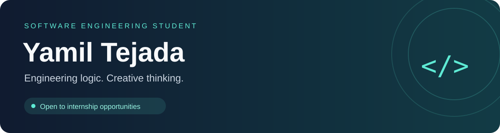
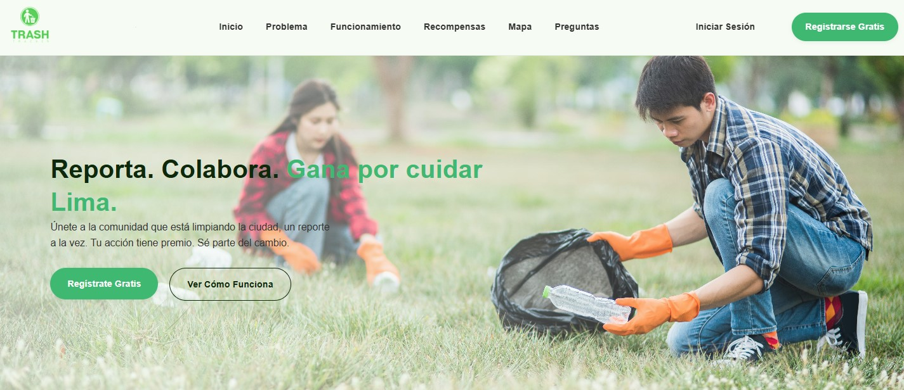
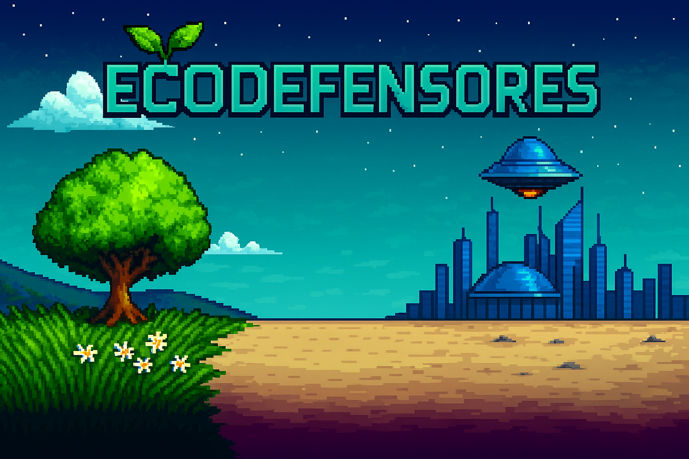

  

<h2 align="center">Hi, I'm Yamil Tejada 👋</h2>

  I'm a 21-year-old <strong>Software Engineering student at UPC</strong>,
  currently in my <strong>fifth semester</strong>.

  Driven by discipline and curiosity, I combine engineering logic with creative design to build software.
  I'm a self-directed learner with <strong>B2 English</strong>, seeking my first internship
  to contribute, learn from others, and grow with a team.

<h2 align="center">Featured Projects</h2>

<table>
  <tr>
    <td width="50%" valign="top" align="center">
      
      <h3>♻️ TrashTracker</h3>
      
A landing page introducing a proposed platform for reporting waste accumulation in Lima and encouraging citizens to take part in caring for their city.

      
<strong>Built with:</strong> HTML · CSS · JavaScript

      <a href="https://github.com/YamilTejada/TrashTracker">
        <strong>Explore repository →</strong>
      </a>
    </td>
    <td width="50%" valign="top" align="center">
      
      <h3>🎮 EcoDefensores</h3>
      
An educational game built with C++/CLI and Windows Forms. Players collect waste and restore ecosystems through challenges that promote environmental awareness.

      
<strong>Focus:</strong> OOP · Collision detection · Game state management

      <a href="https://github.com/YamilTejada/EcoDefensores">
        <strong>Explore repository →</strong>
      </a>
    </td>
  </tr>
  <tr>
    <td colspan="2" align="center">
      <h3>🌐 Want to Know More About Me?</h3>
      
Explore my portfolio for more projects, certificates, my CV, and a little more about my journey! 😄

      <a href="https://yamiltejada.github.io/Portafolio-Web">
        <strong>Take a look →</strong>
      </a>
        
    </td>
  </tr>
</table>

<h2 align="center">Technologies &amp; Tools</h2>

<h3 align="center">Languages</h3>

  

<h3 align="center">Frontend</h3>

  

<h3 align="center">Backend</h3>

  

<h3 align="center">Databases</h3>

  

<h3 align="center">Tools &amp; Design</h3>

  

<h3 align="center">Cloud &amp; Deployment</h3>

  

